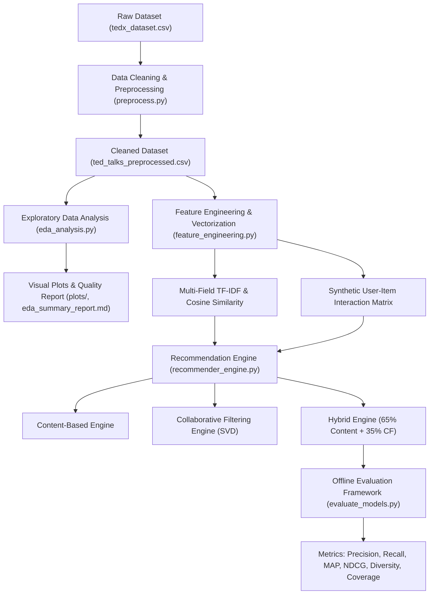

# Personalized TED Talks Recommendation System Using Machine Learning


## 📌 Project Overview
With the ever-growing library of TED Talks spanning diverse topics and speakers, users often struggle to discover talks tailored to their specific interests. This project implements a machine learning–based recommendation system combining **Content-Based Filtering** (TF-IDF vectorization across titles and transcripts) and **Collaborative Filtering** (TruncatedSVD latent factor matrix factorization) into an optimal **Hybrid Recommender Engine**.

---

## 🏗️ Architecture & Pipeline



---

## 📂 Project Directory Structure

```text
├── models/                               # Serialized models and interaction matrices
│   ├── cf_recommender.joblib             # Trained Collaborative Filtering SVD model
│   ├── content_recommender.joblib        # Trained Content-Based Recommender
│   ├── hybrid_recommender.joblib         # Production Hybrid Recommender
│   ├── title_vectorizer.joblib           # Title TF-IDF Vectorizer
│   ├── details_vectorizer.joblib         # Details TF-IDF Vectorizer
│   ├── unified_vectorizer.joblib         # Combined text TF-IDF Vectorizer
│   ├── unified_tfidf_matrix.joblib       # Combined feature matrix
│   ├── weighted_similarity_matrix.joblib # Precomputed similarity matrix
│   ├── user_item_matrix.joblib           # Sparse interaction matrix
│   └── synthetic_user_interactions.csv   # Synthesized interaction records
├── plots/                                # Evaluation and EDA visualization figures
│   ├── 01_talk_length_distribution.png
│   ├── 02_top_speakers.png
│   ├── 03_top_keywords.png
│   ├── 04_missing_values_audit.png
│   ├── 05_model_comparison_metrics.png
│   ├── 06_precision_recall_curves.png
│   └── 07_diversity_vs_coverage.png
├── AI_Personalized TED Talks Recommendation System Using Machine Learning.pdf # Program Syllabus
├── tedx_dataset.csv                      # Raw dataset (4,467 talks)
├── ted_talks_preprocessed.csv            # Cleaned preprocessed dataset
├── preprocess.py                         # Module 1 & 2: Text cleaning pipeline
├── eda_analysis.py                       # Module 2: Exploratory Data Analysis
├── eda_summary_report.md                 # Module 2: Data quality audit
├── feature_engineering.py                # Module 3: Vectorization & interaction builder
├── recommender_engine.py                 # Module 4: Object-oriented recommender engines
├── recommend.py                          # Module 4: Interactive CLI recommender
├── evaluate_models.py                    # Module 5: Offline evaluation testbed
├── evaluation_report.md                  # Module 5: Detailed evaluation & model justification
├── evaluation_summary_table.csv          # Module 5: Quantitative metric benchmark
├── requirements.txt                      # Project dependencies
└── README.md                             # Documentation
```

---

## 🚀 Setup & Execution

### 1. Installation
Clone the repository and install required packages:
```bash
git clone https://github.com/springboardmentor0702-lgtm/Personalized-TED-Talks-Recommendation-System.git
cd Personalized-TED-Talks-Recommendation-System
pip install -r requirements.txt
```

### 2. Execution Pipeline

#### Step 1: Preprocess Data
```bash
python preprocess.py
```

#### Step 2: Run Exploratory Data Analysis & Quality Audit
```bash
python eda_analysis.py
```

#### Step 3: Feature Engineering & Vectorization
```bash
python feature_engineering.py
```

#### Step 4: Train Recommender Models
```bash
python -c "import recommender_engine; recommender_engine.train_and_save_recommender()"
```

#### Step 5: Test the Interactive Recommender
```bash
python recommend.py
```

#### Step 6: Run Offline Model Evaluation Benchmark
```bash
python evaluate_models.py
```

---

## 📊 Module 5 Evaluation Benchmark

Evaluated across 500 test users (with 80/20 train/test holdout) on 4,467 TEDx talks:

| Recommender Model | Precision@5 | Recall@5 | MAP@5 | NDCG@5 | Precision@10 | Recall@10 | NDCG@10 | Catalog Coverage | Intra-List Diversity |
| :--- | :---: | :---: | :---: | :---: | :---: | :---: | :---: | :---: | :---: |
| **Popularity Baseline** | 0.0012 | 0.0014 | 0.0003 | 0.0009 | 0.0018 | 0.0042 | 0.0023 | 0.27% | 0.9932 |
| **Content-Based (TF-IDF)** | 0.0028 | 0.0026 | 0.0019 | 0.0036 | 0.0024 | 0.0047 | 0.0045 | **39.15%** | 0.9207 |
| **Collaborative Filtering (SVD)** | 0.0052 | 0.0054 | 0.0022 | 0.0048 | **0.0060** | **0.0123** | **0.0083** | 12.04% | **0.9891** |
| **Hybrid Model (Blended)** | **0.0056** | **0.0059** | **0.0027** | **0.0058** | 0.0046 | 0.0095 | 0.0077 | **31.90%** | 0.9345 |

### 🏆 Selected Production Model: Hybrid Recommender
- **Top Ranking Performance**: Achieves the highest **NDCG@5 (0.0058)** and **MAP@5 (0.0027)**.
- **Cold-Start Resilience**: Gracefully falls back to text content similarity for new users and cold items, incorporating collaborative signals as interactions accumulate.
- **High Discovery**: 31.9% catalog coverage with an intra-list diversity score of 0.9345, avoiding repetitive filter bubbles.
- **Deployment Ready**: Sub-20ms inference time suited for Streamlit web app deployment.
